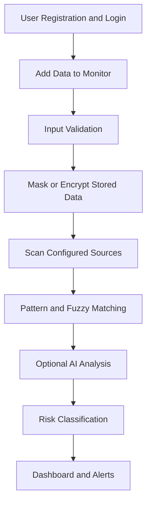

# LeakDetect - AI-Powered Personal Data Leak Detection System

## Project Overview

We developed this project to help users find out whether their personal information has been exposed in data breaches. Most people do not know that their information has been leaked until they face a security issue. Also, leaked data may contain spelling mistakes or different formats, which makes it difficult to identify using exact matching alone.

In this project, we combined rule-based detection, fuzzy matching and optional AI analysis. The application allows users to add information they want to monitor, run a scan and check the results along with the risk level and suggested actions.

## Academic Details

| | |
| --- | --- |
| University | Lakehead University |
| Program | MSc Computer Science |
| Course | (2026F) COMP-5112-FB - Research Methodology Comp Sci |
| Semester | Fall 2026 |
| Group | Group 7 |
| Instructor | Dr. Jinan Fiaidhi |

## Research Question

Can we improve personal data leak detection by combining rule-based detection, fuzzy matching and AI instead of using rule-based detection alone?

## Features Implemented

- User registration and login.
- Monitoring of email addresses, passwords, domains and phone numbers.
- Email and password checks using configured breach services.
- Exact matching and fuzzy matching using RapidFuzz.
- Optional local AI using spaCy and scikit-learn.
- Optional cloud AI using Claude, disabled by default.
- Credit card, SSN and SIN validation using local rules and synthetic test records.
- Manual and scheduled scans.
- Risk classification, detection history and configurable alerts.
- Encrypted storage and password hashing.

## Technologies Used

| Technology | Purpose |
| --- | --- |
| Python and Flask | Backend development |
| HTML, CSS and JavaScript | User interface |
| SQLite and SQLAlchemy | Database management |
| Flask-Login | User authentication |
| Regex and RapidFuzz | Pattern detection and fuzzy matching |
| spaCy and scikit-learn | Local AI analysis |
| Fernet | Field encryption |
| APScheduler | Scheduled scans |
| Claude | Optional cloud AI analysis |

## How the Application Works



1. The user registers and logs in to the application.
2. The user selects the type of information and enters the value to monitor.
3. The application validates the input before saving it.
4. When the user starts a scan, the system checks the configured sources and applies matching rules. AI analysis can also be enabled.
5. If a match is found, the application assigns a risk level and saves the detection.
6. The user can check the source, risk level and suggested actions on the Detections page.

## Data Sources

We used XposedOrNot for email breach checks and Pwned Passwords for compromised password checks. The project also supports the Have I Been Pwned feed, configurable GitHub checks and optional Claude web search.

For credit cards, SSNs and SINs, we used local validation and synthetic records for demonstration. We do not have an authorized provider for checking real-world leaks of these numbers.

## Matching and Risk Levels

We use fuzzy matching for applicable text values such as emails, with a default similarity threshold of 85%. Passwords and sensitive numeric identifiers require exact matching where applicable. The system classifies findings into four risk levels: LOW, MEDIUM, HIGH and CRITICAL.

## Project Structure

```text
Data_Leak_Detector/
├── app.py
├── config.py
├── models.py
├── run.py
├── input_validation.py
├── generate_encryption_key.py
├── requirements.txt
├── .env.example
├── .gitignore
├── engine/
│   ├── ai/
│   ├── database/
│   ├── detectors/
│   ├── scanning/
│   ├── sources/
│   ├── support/
│   └── validation/
├── static/
└── templates/
```

## Getting Started

### 1. Download or clone the repository

Use the GitHub **Code** menu to clone or download the repository. Open a terminal in the directory containing `run.py` and `requirements.txt`.

### 2. Create a virtual environment

**Windows (PowerShell):**

```powershell
python -m venv .venv
.\.venv\Scripts\Activate.ps1
```

**macOS / Linux:**

```bash
python3 -m venv .venv
source .venv/bin/activate
```

### 3. Install dependencies

```bash
python -m pip install -r requirements.txt
python -m spacy download en_core_web_sm
```

### 4. Configure environment variables

Copy `.env.example` to `.env`.

Windows (PowerShell):

```powershell
Copy-Item .env.example .env
```

macOS / Linux:

```bash
cp .env.example .env
```

Generate a Flask secret key:

```bash
python -c "import secrets; print(secrets.token_hex(32))"
```

Set the generated value as `SECRET_KEY` in `.env`.

Generate the required encryption key:

```bash
python generate_encryption_key.py
```

Copy the generated `DATA_ENCRYPTION_KEY=...` line into `.env`, replacing the empty entry. Keep this key private and backed up; losing it can make encrypted data unrecoverable.

| Variable | Purpose |
| --- | --- |
| `SECRET_KEY` | Flask session secret |
| `DATA_ENCRYPTION_KEY` | Required Fernet encryption key |
| `SCRAPER_MODE` | `live`, `mock`, or `both` |
| `ENABLE_SCHEDULER` | Enable scheduled scanning |
| `SCAN_INTERVAL_MINUTES` | Scan interval; default 30 minutes |
| `FUZZY_MATCH_THRESHOLD` | Default similarity threshold: 0.85 |
| `GITHUB_TOKEN` | Optional GitHub credential |
| `ANTHROPIC_API_KEY` | Optional Claude credential |
| `ALLOW_CLOUD_AI_TRIAGE` | Optional cloud triage; default false |
| `AI_WEB_SEARCH` | Optional cloud web search; default false |
| `PHONE_WEB_SEARCH` | Optional phone exposure search; default false |
| `MAIL_SERVER` | Optional email notification server |

To test the application without live breach checks, set `SCRAPER_MODE=mock` and keep cloud features disabled. Live checks send some monitoring values to external services and depend on their availability and rate limits.

### 5. Start the application

```bash
python run.py
```

Open [http://127.0.0.1:5000](http://127.0.0.1:5000) in your browser. The application initializes its database on startup.

## Security and Privacy

We used password hashing for login credentials and Fernet encryption for sensitive stored fields. For credit cards, SSNs and SINs, we save only masked references. Password breach checks are designed to avoid sending plaintext passwords to the breach service. Cloud AI is disabled by default.

Do not upload the `.env` file, API keys, encryption keys or local database to GitHub. Use synthetic data while testing sensitive identifiers.

## Results and Limitations

During our implementation, we demonstrated the complete process from adding information to checking the detection results. We also tested valid and invalid card inputs using the Luhn algorithm and demonstrated email breach checks.

There are still some limitations in our project. A valid card number does not mean that it has been leaked. Similarly, finding information on a public website does not always mean that a breach has occurred. The results also depend on the available data sources.

We have not yet completed the comparison between rule-based detection and hybrid detection using precision, recall and F1-score.

## Future Work

In the future, we would like to compare both detection approaches, reduce false positives, add more authorized data sources and improve the notification system. Further security testing is also required before using the application in a production environment.

## Contributors

- Shoaib Uddin Mohammed
- Kaleem Mohammad

MSc Computer Science, Lakehead University.

## Note

We developed this project for academic research and demonstration purposes. Users should only monitor information they own or have permission to monitor. The application cannot guarantee detection of all data leaks.
